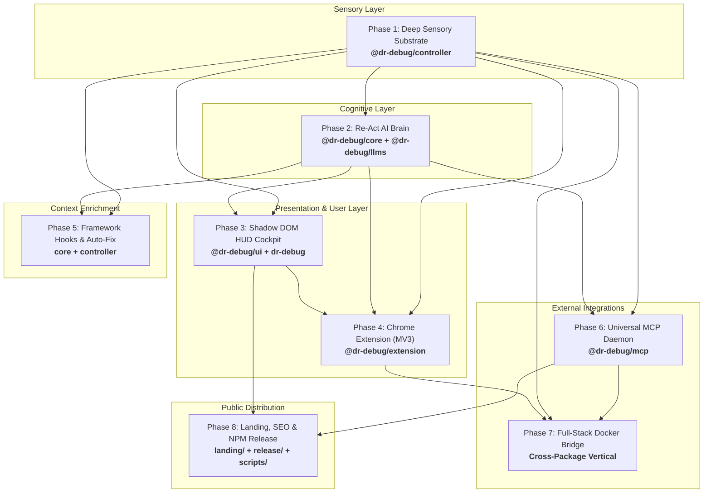

# 🩺 Dr. Debug — Complete Master Feature Crux & Presentation Guide

> **"The Autonomous AI Doctor Living Inside Your Web Application That Observes, Diagnoses, and Prescribes Verified Code Fixes for Live Runtime Bugs."**
> 
> *Page Agent reads the DOM to operate user interfaces. Dr. Debug reads Console + Network + Performance + Memory + Framework State + Host Docker Containers to discover root causes and generate minimal unified diff patches.*

**Architected & Built Entirely by:** [Saswat Mohanty (@SazWhatician)](https://github.com/SazWhatician)  
- 🔗 **GitHub:** [https://github.com/SazWhatician](https://github.com/SazWhatician)  
- 💼 **LinkedIn:** [https://www.linkedin.com/in/saswat-mohanty-0a4549331/](https://www.linkedin.com/in/saswat-mohanty-0a4549331/)  
- 🌐 **Live Landing Page:** [https://dr-debug.vercel.app](https://dr-debug.vercel.app)  
- 📦 **NPM Registry:** [`dr-debug`](https://www.npmjs.com/package/dr-debug) · [`@dr-debug/mcp`](https://www.npmjs.com/package/@dr-debug/mcp)  
- 🧪 **Test Suite Status:** **176 / 176 Tests Passing Monorepo-Wide (34 Test Files, 100% Pass Rate)**  
- 🏷️ **Current Monorepo Release:** `v0.1.21`

---

## 📑 Master Navigation Index

1. [Executive Summary & The 30-Second Elevator Pitch](#1-executive-summary--the-30-second-elevator-pitch)
2. [Key Presentation Metrics & Unfair Advantages](#2-key-presentation-metrics--unfair-advantages)
3. [Competitive Matrix: Dr. Debug vs. Chrome DevTools MCP vs. Sentry](#3-competitive-matrix-dr-debug-vs-chrome-devtools-mcp-vs-sentry)
4. [Monorepo Architecture & The 8 Phases](#4-monorepo-architecture--the-8-phases)
5. [Exhaustive Feature Inventory by System Layer](#5-exhaustive-feature-inventory-by-system-layer)
   - [Layer 1: The Deep Sensory Substrate (10 Interceptors & XML Serializer)](#layer-1-the-deep-sensory-substrate)
   - [Layer 2: The Cognitive AI Brain (Re-Act Engine & 15 Diagnostic Tools)](#layer-2-the-cognitive-ai-brain)
   - [Layer 3: The Shadow DOM Developer Cockpit HUD (UI & Experience)](#layer-3-the-shadow-dom-developer-cockpit-hud)
   - [Layer 4: Delivery & Extension Infrastructure (MV3 & DevTools)](#layer-4-delivery--extension-infrastructure)
   - [Layer 5: Universal Model Context Protocol (MCP) Ecosystem](#layer-5-universal-model-context-protocol-mcp-ecosystem)
   - [Layer 6: Full-Stack Docker Backend Correlation](#layer-6-full-stack-docker-backend-correlation)
   - [Layer 7: Production Distribution, SEO & Landing Page](#layer-7-production-distribution-seo--landing-page)
6. [Slide-by-Slide Presentation Outline & Pitch Deck](#6-slide-by-slide-presentation-outline--pitch-deck)
7. [Live 3-Minute Demo Script & Walkthrough Flow](#7-live-3-minute-demo-script--walkthrough-flow)
8. [Master Monorepo File Matrix](#8-master-monorepo-file-matrix)

---

## 1. Executive Summary & The 30-Second Elevator Pitch

### The Core Problem (The Manual Debugging Tax)
Every frontend and full-stack software engineer suffers through the same fragmented, painful debugging ritual:
1. An API endpoint fails with a `500 Internal Server Error`, `503 Service Unavailable`, `401 Unauthorized`, or a silent CORS block.
2. The user interface crashes 3 render frames later with `TypeError: Cannot read property of undefined`.
3. The developer manually switches between Chrome **Console** (stack trace), **Network** tab (headers & response payloads), **Performance** flamecharts, and **Terminal** (Docker container logs).
4. The developer copy-pastes pieces of this fragmented state into an external LLM chat window (ChatGPT, Claude).
5. The LLM hallucinates or gives vague advice because **it has no access to live runtime execution memory, active network bodies, demangled source maps, or host backend logs**.

### The Dr. Debug Solution
**Dr. Debug** eliminates the entire manual debugging loop. It is an **autonomous, in-browser AI debugging and observability agent** that embeds directly into your web application via an isolated Shadow DOM container or Chrome Extension. 
- It silently monitors 10 browser substrates without overhead.
- When an anomaly triggers, it executes an autonomous **Re-Act (Reflect → Act → Evaluate) reasoning loop** using 15 specialized diagnostic tools.
- It correlates frontend client errors with **exact millisecond-timestamped Docker backend container logs & SQL queries**.
- It outputs a verified diagnosis, root-cause breadcrumb trail, and an actionable **≤ 5-line unified code diff (`.patch`)** with 1-click IDE agent handoff.
- It exposes live browser telemetry to IDE agents (Cursor, Claude Code, Google Antigravity) via the **Model Context Protocol (MCP)**.

---

## 2. Key Presentation Metrics & Unfair Advantages

Use these hard-hitting statistics and architectural breakthroughs in your presentation:

| Metric / Innovation | Measured Benchmark | Presentation Talking Point |
|:---|:---|:---|
| **Test Suite Verification** | **176 / 176 passing tests** (34 test files) | 100% production-ready test pass rate covering all 7 packages. |
| **Monorepo Scale** | **7 packages** (v0.1.21) | Fully decoupled: controller, core, llms, ui, dr-debug, extension, mcp. |
| **Token Context Economy** | **80%–90% reduction** (~400–600 tokens vs 40k–80k) | **Ponytail Protocol**: Slashes prompt tokens and AI credit costs by 95% compared to raw CDP dumps. |
| **Sensory Organs** | **10 passive interceptors** | Console, Network (Fetch+XHR), Performance, Memory, Docker, Framework (React/Redux/Vue/Svelte), Interaction Replay, Layout, Network Mock, SQL. |
| **Cognitive Tools** | **15 diagnostic tools** | Stack demangling, request inspection, Docker grep, causal DAG, JS eval, test synthesis, patch generation. |
| **MCP Integration** | **8 tools, 7 resources, 2 prompts** | Dual STDIO + HTTP transport on port 9229. Native plug-and-play for Cursor, Claude Code, Antigravity. |
| **Backend Correlation** | **3-second temporal window** | Instantly pairs frontend HTTP 500s with backend Docker panics & Python/Go/Node tracebacks. |
| **Flight Recorder** | **30-second interaction ring buffer** | Automatic PII masking (`[REDACTED]`) records user clicks, inputs, and scrolls before a crash. |
| **Lighthouse Speed** | **LCP < 2s** (down from 8.6s), **TBT < 100ms** | Preloaded hero canvas, progressive idle streaming via `requestIdleCallback`. |
| **Visual Polish** | **4 master themes + 6 audio profiles** | Cyber-Cyan, Frosted Light, Slate Skeuomorphic, Windows XP Retro, Web Audio chimes, 8-bit Pokemon easter egg. |

---

## 3. Competitive Matrix: Dr. Debug vs. Chrome DevTools MCP vs. Sentry

This comparison slide is guaranteed to blow away technical audiences and evaluators:

| Dimension | Google `chrome-devtools-mcp` | Traditional APM (Sentry / Datadog) | 🩺 Dr. Debug (`DebugCopilot`) |
|:---|:---|:---|:---|
| **Primary Mission** | Browser automation actuator (`click`, `type`, CDP wrapper) | Post-mortem production crash monitoring & reporting | **Autonomous in-browser live runtime diagnosis & code repair** |
| **Backend Visibility** | ❌ Blind outside the browser tab | ⚠️ Requires distributed tracing agents & heavy cloud backend | ✅ **Host `DockerBridge`** streams container logs & DB panics to client |
| **User Crash Reproduction** | ❌ Only records synthetic robot actions | ⚠️ Heavy video session recording (MBs of video data) | ✅ **Zero-overhead 30s Flight Recorder** with automatic PII masking |
| **Diagnostic Reasoning** | ❌ None (IDE LLM must manually guess CDP calls) | ❌ None (static error dashboard with isolated call stacks) | ✅ **Autonomous Re-Act loop** with forced Zod reflection before action |
| **Token Consumption** | ❌ **40,000–80,000 tokens** (raw HTML, CDP protocol bloat) | N/A (Not an LLM agent) | ✅ **800–1,500 tokens** (RFC-9457 compressed `<debug_state>` XML) |
| **Actionable Output** | ❌ Raw DOM snapshots or browser screenshots | ❌ Aggregated graphs and error stack lines | ✅ **Verified root-cause + ≤5-line unified `.patch` + Playwright test** |
| **Developer Interface** | ❌ Headless STDIO only (no UI) | ❌ External cloud dashboard web app | ✅ **Zero-bleed Shadow DOM HUD**, Chrome Extension, & DevTools panel |
| **Privacy & Zero Cost** | ❌ Dumps full browser state to cloud LLM APIs | ❌ Ships user telemetry to third-party cloud SaaS | ✅ **100% localhost & on-device WebGPU inference** via LiteRT & Ollama |

---

## 4. Monorepo Architecture & The 8 Phases

Dr. Debug is organized into 7 modular, decoupled packages and distribution directories:



---

## 5. Exhaustive Feature Inventory by System Layer

### Layer 1: The Deep Sensory Substrate
**Package:** [`@dr-debug/controller`](file:///c:/Users/saswa/Desktop/DebugCopilot/packages/controller/) · **Lead File:** [`DebugController.ts`](file:///c:/Users/saswa/Desktop/DebugCopilot/packages/controller/src/DebugController.ts)

1. **Master Sensory Orchestrator ([`DebugController`](file:///c:/Users/saswa/Desktop/DebugCopilot/packages/controller/src/DebugController.ts)):**
   - Single coordinator managing all 10 interceptor instances.
   - Provides consolidated runtime snapshots via `getSnapshot()`.
   - Token-budgeted XML serialization via `serialize()`.
   - Manages Docker bridge connections and causal DAG compilation.
2. **Console & Exception Interceptor ([`console.ts`](file:///c:/Users/saswa/Desktop/DebugCopilot/packages/controller/src/interceptors/console.ts)):**
   - Intercepts `window.onerror`, `window.unhandledrejection`, and wraps `console.error`, `warn`, `info`, `log`.
   - Maintains a 100-item circular ring buffer preventing memory leaks.
   - Intelligent deduplication: increments burst counter and updates `lastSeen` timestamp without blowing up memory.
   - Parses raw stack traces into structured `StackFrame[]` (`functionName`, `filename`, `lineno`, `colno`).
3. **Network Interceptor ([`network.ts`](file:///c:/Users/saswa/Desktop/DebugCopilot/packages/controller/src/interceptors/network.ts)):**
   - Intercepts `window.fetch` and monkey-patches `XMLHttpRequest.prototype`.
   - Non-destructive body inspection using `response.clone()` (never locks or consumes application streams).
   - Captures HTTP method, URL, status code, duration, TTFB, and request/response headers.
   - Automatic CORS failure detection (`status === 0` + `net::ERR_FAILED`).
   - Self-traffic filtering: tags internal MCP sync calls with `X-Dr-Debug-Internal: true` to prevent recursive capture loops.
4. **Performance & Web Vitals Interceptor ([`performance.ts`](file:///c:/Users/saswa/Desktop/DebugCopilot/packages/controller/src/interceptors/performance.ts)):**
   - Attaches `PerformanceObserver` instances for `longtask` (>50ms main-thread freeze).
   - Monitors Core Web Vitals: Largest Contentful Paint (LCP), Cumulative Layout Shift (CLS), Interaction to Next Paint (INP), FCP, and TTFB.
   - Assigns automatic ratings: `good`, `needs-improvement`, or `poor`.
   - Flags slow network resource fetches exceeding 1500ms.
5. **Memory & DOM Node Monitor ([`memory.ts`](file:///c:/Users/saswa/Desktop/DebugCopilot/packages/controller/src/interceptors/memory.ts)):**
   - Samples Chromium `performance.memory` heap usage (`usedJSHeapSize`, `totalJSHeapSize`, `jsHeapSizeLimit`).
   - Continuously counts active DOM nodes (`document.querySelectorAll('*').length`).
   - Calculates leak velocity trends in MB/minute.
6. **Docker Interceptor ([`docker.ts`](file:///c:/Users/saswa/Desktop/DebugCopilot/packages/controller/src/interceptors/docker.ts)):**
   - In-memory circular buffer (up to 500 lines) storing container list metadata and real-time backend log lines.
7. **Framework Interceptor ([`framework.ts`](file:///c:/Users/saswa/Desktop/DebugCopilot/packages/controller/src/interceptors/framework.ts)):**
   - Introspects `__REACT_DEVTOOLS_GLOBAL_HOOK__` for React component hierarchies and fiber commit events.
   - Hooks `__REDUX_DEVTOOLS_EXTENSION__` / `__REDUX_STORE__` for dispatched action logs and state snapshots.
   - Supports Vue 3 devtools global hook and Svelte runtime context detection.
8. **User Interaction Interceptor ([`interaction.ts`](file:///c:/Users/saswa/Desktop/DebugCopilot/packages/controller/src/interceptors/interaction.ts)):**
   - 30-second ring buffer recording user clicks, masked inputs, scrolls, and navigations.
   - Automatic PII redaction: masks password fields, credit card regex patterns, email patterns, and `data-private` tags into `[REDACTED]`.
   - Generates human-readable reproduction sequences for incident reports.
9. **CSS Layout Anomaly Inspector ([`layoutInspector.ts`](file:///c:/Users/saswa/Desktop/DebugCopilot/packages/controller/src/interceptors/layoutInspector.ts)):**
   - Detects layout clipping (`overflow: hidden`), invisible overlay click-traps, zero-size elements, offscreen elements, and z-index stacking context traps.
10. **Network Mock Engine ([`networkMock.ts`](file:///c:/Users/saswa/Desktop/DebugCopilot/packages/controller/src/interceptors/networkMock.ts)):**
    - Synthetic mock layer intercepting outgoing fetch/XHR calls to return custom status codes, bodies, and headers for hypothesis testing.
11. **SQL N+1 Query Correlator ([`sqlCorrelator.ts`](file:///c:/Users/saswa/Desktop/DebugCopilot/packages/controller/src/interceptors/sqlCorrelator.ts)):**
    - Parses HTTP `Server-Timing` headers on API responses to correlate database query bursts and flag N+1 query patterns.
12. **42KB Analytical Serializer Engine ([`serializer.ts`](file:///c:/Users/saswa/Desktop/DebugCopilot/packages/controller/src/serializer.ts)):**
    - `debugStateToString()`: Compresses multi-substrate state into token-budgeted `<debug_state>` XML (800–1,500 tokens).
    - `buildCausalErrorGraph()`: Builds multi-layer causal error DAG (Docker → Network → Console → DOM) with root-cause identification.
    - `computeCorrelations()`: Links events occurring within a 3-second temporal correlation window.
    - `computeDiagnosticMatrix()`: Calculates 2D Substrate × Severity heatmap grid.
    - `generateCurlCommand()`: Reconstructs exact terminal-executable `curl` reproduction commands from captured network requests.
    - `getHttpStatusExplainer()`: Provides RFC-accurate plain-English explanations and recommended fixes for any HTTP status code.

---

### Layer 2: The Cognitive AI Brain
**Packages:** [`@dr-debug/core`](file:///c:/Users/saswa/Desktop/DebugCopilot/packages/core/) & [`@dr-debug/llms`](file:///c:/Users/saswa/Desktop/DebugCopilot/packages/llms/)

1. **Autonomous Re-Act Loop ([`DrDebugCore.ts`](file:///c:/Users/saswa/Desktop/DebugCopilot/packages/core/src/DrDebugCore.ts)):**
   - Iterative cycle: Observe → Formulate Hypothesis → Act (Call Tool) → Evaluate Observation → Repeat.
   - Max 8 diagnostic turns with early exit as soon as root cause is confirmed.
2. **Forced Reflection-Before-Action Schema ([`types.ts`](file:///c:/Users/saswa/Desktop/DebugCopilot/packages/core/src/types.ts)):**
   - Validates AI responses against a strict Zod schema:
     - `evaluation_previous_goal`: Validates if prior hypothesis was confirmed or rejected.
     - `working_hypothesis`: Current working theory of what broke.
     - `memory`: Cumulative evidence retained across steps.
     - `next_goal`: Precise objective of the next diagnostic tool call.
     - `action`: Structured tool invocation schema.
3. **Tool Name Normalization & Hallucination Resistance:**
   - Automatically maps 20+ hallucinated tool aliases (e.g. `eval_js` → `execute_javascript`, `causal_graph` → `graphify_errors`, `finish` → `done`).
4. **Autonomous Fallback Triage (Deterministic Reliability):**
   - If the LLM produces invalid outputs or stalls, DrDebugCore automatically triages uninspected network failures, console errors, and causal topologies. Dr. Debug **always** outputs a diagnosis.
5. **The 15 Diagnostic Tools Inventory ([`packages/core/src/tools/`](file:///c:/Users/saswa/Desktop/DebugCopilot/packages/core/src/tools/)):**

| Tool Name | File Path | Core Function & Capability |
|:---|:---|:---|
| `inspect_error` | [`inspect_error.ts`](file:///c:/Users/saswa/Desktop/DebugCopilot/packages/core/src/tools/inspect_error.ts) | Demangles stack traces, filters vendor vs app code, parses line numbers. |
| `inspect_request` | [`inspect_request.ts`](file:///c:/Users/saswa/Desktop/DebugCopilot/packages/core/src/tools/inspect_request.ts) | Deep inspects request/response headers, body payloads, timing breakdown, and cURL. |
| `inspect_docker_logs` | [`inspect_docker_logs.ts`](file:///c:/Users/saswa/Desktop/DebugCopilot/packages/core/src/tools/inspect_docker_logs.ts) | Grep/regex search across host Docker container logs, detecting backend panics. |
| `graphify_errors` | [`graphify_errors.ts`](file:///c:/Users/saswa/Desktop/DebugCopilot/packages/core/src/tools/graphify_errors.ts) | Builds Causal Error DAG across substrates with Mermaid diagram export. |
| `inspect_element` | [`inspect_element.ts`](file:///c:/Users/saswa/Desktop/DebugCopilot/packages/core/src/tools/inspect_element.ts) | Inspects DOM bounding boxes, computed styles, and event listeners. |
| `inspect_layout` | [`inspect_layout.ts`](file:///c:/Users/saswa/Desktop/DebugCopilot/packages/core/src/tools/inspect_layout.ts) | Evaluates CSS layout anomalies (overflow clipping, invisible overlays, zero size). |
| `query_framework_state` | [`query_framework_state.ts`](file:///c:/Users/saswa/Desktop/DebugCopilot/packages/core/src/tools/query_framework_state.ts) | Dumps React component tree, props, state, Redux actions, Vue/Svelte context. |
| `execute_javascript` | [`execute_javascript.ts`](file:///c:/Users/saswa/Desktop/DebugCopilot/packages/core/src/tools/execute_javascript.ts) | Safely evaluates JavaScript expressions in the page with timeout protection. |
| `find_correlations` | [`find_correlations.ts`](file:///c:/Users/saswa/Desktop/DebugCopilot/packages/core/src/tools/find_correlations.ts) | Clusters temporal events across network, console, and user actions. |
| `replay_network_request` | [`replay_network_request.ts`](file:///c:/Users/saswa/Desktop/DebugCopilot/packages/core/src/tools/replay_network_request.ts) | Re-sends failed HTTP requests with mutated headers/payloads to test determinism. |
| `mock_response` | [`mock_response.ts`](file:///c:/Users/saswa/Desktop/DebugCopilot/packages/core/src/tools/mock_response.ts) | Injects mock network rules to verify if fixed API responses resolve errors. |
| `synthesize_test` | [`synthesize_test.ts`](file:///c:/Users/saswa/Desktop/DebugCopilot/packages/core/src/tools/synthesize_test.ts) | Auto-generates executable Playwright E2E regression tests from observed bugs. |
| `generate_patch` | [`generate_patch.ts`](file:///c:/Users/saswa/Desktop/DebugCopilot/packages/core/src/tools/generate_patch.ts) | Converts proposed fixes into standard unified git diffs and GitHub PR bodies. |
| `check_storage` | [`check_storage.ts`](file:///c:/Users/saswa/Desktop/DebugCopilot/packages/core/src/tools/check_storage.ts) | Inspects localStorage, sessionStorage, and cookies for expired JWTs or corrupt state. |
| `done` | [`done.ts`](file:///c:/Users/saswa/Desktop/DebugCopilot/packages/core/src/tools/done.ts) | Formal conclusion emitting diagnosis, root cause, confidence, diff, and debugRoute. |

6. **Model-Agnostic LLM Layer ([`@dr-debug/llms`](file:///c:/Users/saswa/Desktop/DebugCopilot/packages/llms/)):**
   - **`OpenAIClient`:** Unified cloud adapter auto-detecting Groq (`gsk_`), Gemini (`AIza`/`AQ.`), and OpenAI API keys. Supports custom `baseURL` for self-hosted local models (Ollama, vLLM, LM Studio). Features 3-tier exponential backoff retry and 429 rate limit parsing.
   - **`LiteRTClient`:** Google LiteRT.js on-device inference adapter running WebGPU and WASM models directly in the browser with **zero API key requirement**.
   - **`HeuristicLLMClient`:** Offline deterministic diagnostic engine that operates completely without an LLM or cloud connection.
   - **`MockLLMClient`:** Deterministic fixture player for automated unit tests.
7. **The Ponytail Minimality Protocol ([`SessionReport.ts`](file:///c:/Users/saswa/Desktop/DebugCopilot/packages/core/src/analysis/SessionReport.ts)):**
   - Achieves 80%–90% token reduction (~400–600 tokens) via surgical telemetry pruning.
   - Filters vendor stack frames, bursts error duplicates, and outputs the **Ponytail Minimality Ladder** directive:
     - Target diff ≤ 5 lines
     - YAGNI (fix only the verified root cause)
     - Standard library first (optional chaining `?.`, nullish coalescing `??`)
     - Zero new dependencies
     - Never compromise validation or security
8. **Automated Auto-Fix & Test Synthesis Engines:**
   - **`PatchEngine` ([`PatchEngine.ts`](file:///c:/Users/saswa/Desktop/DebugCopilot/packages/core/src/patch/PatchEngine.ts)):** Generates standard `.patch` files and complete, ready-to-merge GitHub Pull Request markdown descriptions with reproduction steps.
   - **`TestSynthesizer` ([`TestSynthesizer.ts`](file:///c:/Users/saswa/Desktop/DebugCopilot/packages/core/src/patch/TestSynthesizer.ts)):** Compiles recorded user interaction sequences and failed network requests into automated Playwright regression tests.

---

### Layer 3: The Shadow DOM Developer Cockpit HUD
**Packages:** [`@dr-debug/ui`](file:///c:/Users/saswa/Desktop/DebugCopilot/packages/ui/) & [`dr-debug`](file:///c:/Users/saswa/Desktop/DebugCopilot/packages/dr-debug/)

1. **Zero-Bleed Shadow DOM Isolation ([`DrDebugUI.ts`](file:///c:/Users/saswa/Desktop/DebugCopilot/packages/ui/src/DrDebugUI.ts)):**
   - Mounts inside `#dr-debug-root` in `open` shadow mode.
   - Injects 134KB+ of artisanal CSS with `!important` resets. Host application styles (Tailwind, Bootstrap, MUI) cannot bleed in or out.
   - Trusted Types & Strict CSP safe: uses pure DOM node factories (`createElement`, `createTextNode`), never unsafe `innerHTML`.
2. **The Floating Pill ([`FloatingPill.ts`](file:///c:/Users/saswa/Desktop/DebugCopilot/packages/ui/src/components/FloatingPill.ts)):**
   - Draggable across viewport with modern Pointer Events and pointer capture.
   - Magnetic edge snapping to screen borders with localStorage position persistence.
   - **Live Equalizer Visualizer Bars:** 3 animated equalizer bars responding to telemetry traffic.
   - Real-time status chips: `1 ERR`, `2 NET`, `1 SLOW`, `DIAGNOSING`, `HEALTHY`.
   - **Stealth Bezel Collapse:** Double-clicking collapses the pill into an unobtrusive bezel orb.
   - **Recenter Action:** Smoothly resets the pill to bottom-right home position.
3. **The 6-Tab Cockpit Panel ([`CockpitPanel.ts`](file:///c:/Users/saswa/Desktop/DebugCopilot/packages/ui/src/components/CockpitPanel.ts)):**
   - **Tab 1: Error Matrix** — 2D Substrate × Severity heatmap grid.
   - **Tab 2: Telemetry** — Live console errors, slow requests, and memory statistics.
   - **Tab 3: Causal Graph** — Native SVG interactive Directed Acyclic Graph.
   - **Tab 4: 🐳 Docker** — Container fleet status and real-time streaming log terminal.
   - **Tab 5: Timeline** — Step-by-step AI investigation trajectory with working hypotheses.
   - **Tab 6: Prescription** — 3-Tier diagnostic blueprint with unified diff and 1-click IDE copy.
   - **1-Click Smart Action Bar:** Single-click `[⚡ Generate AI Debug Route & Solution]` with live issue counters.
   - Interactive `(i)` Guide modals for each tab explaining substrate mechanics.
4. **2D Error Diagnostic Matrix & Workbench ([`ErrorDashboardView.ts`](file:///c:/Users/saswa/Desktop/DebugCopilot/packages/ui/src/components/ErrorDashboardView.ts)):**
   - Interactive 2D heatmap matrix (Network, Runtime JS, Docker, System × Critical, High, Notice).
   - Click any cell to filter the incident workbench.
   - Mode switcher: Matrix Grid view vs Chronological Timeline Stream with live search bar.
   - Error Inspector modal showing demangled application code, request headers, RFC status explanations, and executable cURL reproduction commands.
   - Inspector state caching preventing UI re-render thrashing during background telemetry syncs.
5. **Interactive Causal Graph View ([`CausalGraphView.ts`](file:///c:/Users/saswa/Desktop/DebugCopilot/packages/ui/src/components/CausalGraphView.ts)):**
   - Native SVG DAG visualizer color-coded by layer (Docker: blue, Network: orange, Console: red, DOM: green).
   - Highlights the verified root cause node with a pulse badge.
   - Click-to-inspect node details and 1-click Mermaid diagram export.
6. **Host Docker Dashboard ([`DockerDashboardView.ts`](file:///c:/Users/saswa/Desktop/DebugCopilot/packages/ui/src/components/DockerDashboardView.ts)):**
   - Real-time container fleet status cards (running, restarting, exited, port mappings).
   - Virtualized monospace live log terminal with millisecond ISO timestamps.
   - Color-coded severity badges (`[FATAL]`, `[ERROR]`, `[WARN]`, `[INFO]`, `[DEBUG]`).
   - Smart autoscroll that automatically disengages when the user manually scrolls up to read a stack trace.
   - Real-time regex grep search and severity level filters.
   - 1-Click Container AI RCA: `[⚡ Correlate Container Logs]`.
7. **Synthesized Web Audio Chimes ([`AudioChimes.ts`](file:///c:/Users/saswa/Desktop/DebugCopilot/packages/ui/src/components/AudioChimes.ts)):**
   - Zero-dependency Web Audio API sound synthesizer with zero external audio assets.
   - 6 selectable sound profiles:
     1. *Warp Drop* (Dr. Debug signature 880Hz → 440Hz dual-frequency slide)
     2. *Sonar Pulse* (Submarine tactical acoustic ping)
     3. *Cyber Glitch* (Frequency-modulated high-speed chirp)
     4. *Subtle Bell* (659Hz crystal harmonic ping)
     5. *Retro Synth* (8-bit arcade warning square-wave)
     6. *Arcade 8-Bit* (Chiptune battle quest alert)
   - Tactile audio feedback on incident detection, triage start, step completion, and prescription ready.
8. **Retro Pixel Easter Egg Engine ([`PixelEasterEgg.ts`](file:///c:/Users/saswa/Desktop/DebugCopilot/packages/ui/src/components/PixelEasterEgg.ts)):**
   - Authentic 8-bit vector pixel-art sprites: **Pikachu, Gengar, Charizard, Bulbasaur, Street Fighter Ryu (with waving red bandana), Spider-Man, and Pixel Doctor**.
   - 100% pure SVG matrices, crispEdges rendering, zero external HTTP requests, 100% CSP safe.
   - Characters peek up from behind the HUD bezel, glance around, and duck down with retro sound effects.
9. **In-Page Stethoscope Inspector ([`StethoscopeInspector.ts`](file:///c:/Users/saswa/Desktop/DebugCopilot/packages/ui/src/components/StethoscopeInspector.ts)):**
   - Click-to-inspect visual element biopsy tool.
   - Hover over any element on the page to display an interactive neon outline with tag name, dimensions, and component identity.
   - Click captures element state, styles, and event listeners directly into Dr. Debug.
10. **Offline Incident Bundle Exporter ([`IncidentExporter.ts`](file:///c:/Users/saswa/Desktop/DebugCopilot/packages/ui/src/components/IncidentExporter.ts)):**
    - `exportHTML()`: Generates a self-contained, beautifully styled, zero-dependency HTML incident report with embedded graphs, telemetry tables, and unified diffs.
    - `copyGitHubIssue()`: Formats complete incident into GitHub/Linear Flavored Markdown and copies to clipboard.
11. **Hands-Free Voice Debugger ([`VoiceDebugger.ts`](file:///c:/Users/saswa/Desktop/DebugCopilot/packages/ui/src/components/VoiceDebugger.ts)):**
    - Powered by Web Speech API (`SpeechRecognition` & `speechSynthesis`).
    - Speak queries directly (*"Diagnose the CORS error on checkout"*); Dr. Debug transcribes, dispatches an investigation, and speaks back audio confirmation.
12. **5 Master Visual Themes ([`styles.ts`](file:///c:/Users/saswa/Desktop/DebugCopilot/packages/ui/src/styles.ts)):**
    - *Dr.Debug Signature Cyan:* Obsidian backdrop, neon cyan accents, glassmorphic blur.
    - *Minimalistic Frosted Light:* Quartz white translucency, slate typography, hairline borders.
    - *Monotone Skeuomorphic:* Matte industrial graphite, tactile beveled borders, amber phosphor alerts.
    - *Windows XP Classic Retro:* Authentic Luna blue titlebar gradients, beveled 3D borders, retro typography.
    - *Arcade 8-Bit:* Retro gaming visual palette activating the Pixel Easter Egg engine and chiptune sound effects.
13. **Bulletproof SPA Navigation & Self-Healing Lifecycle:**
    - Intercepts `history.pushState`, `history.replaceState`, `popstate`, `hashchange`, Turbo, and Astro View Transitions.
    - Multi-level `MutationObserver` on `documentElement` and `body` automatically detects when SPAs (Next.js, React 18 hydration) wipe the DOM and immediately re-attaches `#dr-debug-root`.
    - Watchdog heartbeat runs every 800ms to guarantee zero UI disappearance.
14. **First-Class React Component Wrapper ([`DrDebugReact.ts`](file:///c:/Users/saswa/Desktop/DebugCopilot/packages/ui/src/components/DrDebugReact.ts)):**
    - `<DrDebugCockpit />` / `DrDebugReact`: SSR-safe drop-in component for Next.js App Router (`layout.tsx`), Pages Router (`_app.tsx`), Remix (`root.tsx`), and Vite.
15. **Standalone `<script>` Tag Drop-In ([`standalone.ts`](file:///c:/Users/saswa/Desktop/DebugCopilot/packages/dr-debug/src/standalone.ts)):**
    - Zero-build 1-line script embed parsing `data-*` attributes (`data-model`, `data-api-key`, `data-theme`, `data-auto-investigate`).

---

### Layer 4: Delivery & Extension Infrastructure
**Package:** [`@dr-debug/extension`](file:///c:/Users/saswa/Desktop/DebugCopilot/packages/extension/)

1. **Manifest V3 Architecture ([`manifest.json`](file:///c:/Users/saswa/Desktop/DebugCopilot/packages/extension/manifest.json)):**
   - Zero-setup extension running on any website, staging server, or production environment without modifying source code.
2. **Three-Layer Bridge Architecture (Solves 3 Hard Security Problems):**
   - **MAIN World Content Script ([`content.ts`](file:///c:/Users/saswa/Desktop/DebugCopilot/packages/extension/src/content.ts)):** Runs at `document_start` in the page's execution context to patch native browser APIs and mount the UI.
   - **ISOLATED World Bridge ([`bridge.ts`](file:///c:/Users/saswa/Desktop/DebugCopilot/packages/extension/src/bridge.ts)):** Secure firewall relaying messages between page `window.postMessage` and extension `chrome.runtime`.
   - **Background Service Worker ([`background.ts`](file:///c:/Users/saswa/Desktop/DebugCopilot/packages/extension/src/background.ts)):** Executes CSP-exempt LLM API calls, manages persistent Docker SSE streams, and securely stores API keys.
   - **Three Problems Solved:**
     1. *Page CSP Bypass:* Pages with strict `connect-src 'self'` cannot block LLM calls because the background worker executes them with elevated extension host permissions.
     2. *API Key Security:* API keys are stored in `chrome.storage.local` and never touch page JavaScript.
     3. *HTTPS Mixed Content Bypass:* HTTPS pages connecting to `http://localhost:9229` are proxied through the background worker.
3. **Dedicated Chrome DevTools Panel ([`panel.html`](file:///c:/Users/saswa/Desktop/DebugCopilot/packages/extension/panel.html) & [`panel.js`](file:///c:/Users/saswa/Desktop/DebugCopilot/packages/extension/panel.js)):**
   - Native DevTools tab alongside Elements, Console, and Network.
   - 3 live monospace streams: Docker container logs, Network requests, and Console events.
   - Embedded 2D Diagnostic Matrix, Causal Graph, cURL generator, and 1-click Markdown / JSON RCA exporter ([`panel.ts`](file:///c:/Users/saswa/Desktop/DebugCopilot/packages/extension/src/devtools/panel.ts)).
4. **Browser Toolbar Popup ([`popup.html`](file:///c:/Users/saswa/Desktop/DebugCopilot/packages/extension/popup.html) & [`popup.js`](file:///c:/Users/saswa/Desktop/DebugCopilot/packages/extension/popup.js)):**
   - Quick provider selector, API key manager, and 1-click `[Toggle HUD]` and `[⚡ Run AI Diagnosis]` triggers.
5. **Source Map Demangling Engine ([`SourceMapResolver.ts`](file:///c:/Users/saswa/Desktop/DebugCopilot/packages/extension/src/sourcemaps/SourceMapResolver.ts)):**
   - Fast Base64-VLQ decoder and SourceMap V3 parser.
   - Unminifies production bundle errors (`bundle.min.js:1:24567`) back to original TypeScript/JSX source lines (`UserProfile.tsx:47:12`).

---

### Layer 5: Universal Model Context Protocol (MCP) Ecosystem
**Package:** [`@dr-debug/mcp`](file:///c:/Users/saswa/Desktop/DebugCopilot/packages/mcp/) · **CLI Binary:** `npx @dr-debug/mcp`

1. **Dual Transport Architecture:**
   - **STDIO JSON-RPC 2.0:** Standard pipe connecting IDE AI agents (Cursor, Claude Desktop, Claude Code, Windsurf, Antigravity IDE).
   - **HTTP Server on Port 9229:** Browser telemetry ingestion (`POST /telemetry`), Docker SSE stream (`GET /docker/stream`), container queries, and extension auto-updater (`POST /update-extension`).
2. **Port Sharing & Multi-Session Mode:**
   - If port 9229 is already taken by another Dr. Debug daemon, gracefully enters shared telemetry mode, polling active sessions via `GET /sessions` every 2.5s.
3. **8 Production MCP Tools ([`tools.ts`](file:///c:/Users/saswa/Desktop/DebugCopilot/packages/mcp/src/tools.ts)):**

| Tool Name | Parameters | Capabilities & Output |
|:---|:---|:---|
| `drdebug_get_diagnostics` | `tabId?` | Aggregated health status across all substrates, error counts, leak velocity. |
| `drdebug_inspect_request` | `requestId` | Full request/response payloads, status codes, timing, headers, executable cURL. |
| `drdebug_get_ai_brief` | `targetId?` | Surgical Ponytail incident brief (80%–90% token reduction) formatted for IDE agents. |
| `drdebug_inspect_error` | `errorId` | Demangled stack frames highlighting app code vs vendor libraries with burst counts. |
| `drdebug_get_interaction_replay` | _(none)_ | 30-second chronological user interaction sequence with PII redaction. |
| `drdebug_execute_script` | `expression`, `tabId?` | Evaluates arbitrary JavaScript inside the live browser tab and returns results. |
| `drdebug_list_docker_containers` | _(none)_ | Lists local host Docker containers with IDs, names, images, state, and ports. |
| `drdebug_get_docker_logs` | `container?`, `level?`, `grep?`, `tail?` | Filters and queries host Docker container logs with regex search. |

4. **7 MCP Resources ([`resources.ts`](file:///c:/Users/saswa/Desktop/DebugCopilot/packages/mcp/src/resources.ts)):**
   - `drdebug://state/live`: Real-time `<debug_state>` XML token snapshot.
   - `drdebug://console/errors`: Active uncaught errors and demangled stack frames.
   - `drdebug://network/failures`: Failed HTTP transactions with full payloads.
   - `drdebug://interactions/replay`: Chronological 30-second user interaction log.
   - `drdebug://matrix/diagnostics`: 2D Substrate × Severity JSON grid.
   - `drdebug://tab/{tabId}/state`: Tab-specific telemetry snapshot (dynamic template).
   - `drdebug://container/{containerId}/logs`: Container-specific log stream (dynamic template).
5. **2 MCP Incident Prompts:**
   - `drdebug_triage_incident`: Synthesizes current live browser telemetry into a structured triage directive.
   - `drdebug_correlate_500`: Correlates frontend failed HTTP requests with backend Docker container logs.

---

### Layer 6: Full-Stack Docker Backend Correlation
**Cross-Package Integration:** `mcp` ↔ `extension` ↔ `controller` ↔ `ui`

1. **Host Docker Daemon Observer ([`DockerBridge.ts`](file:///c:/Users/saswa/Desktop/DebugCopilot/packages/mcp/src/DockerBridge.ts)):**
   - Spawns `docker version` for daemon detection (with 8s retry polling if Docker Desktop starts late).
   - Polls `docker ps` every 5 seconds for container lifecycle discovery.
   - Spawns `docker logs --follow --tail 50 --timestamps` child processes for every running container.
   - Parses ISO timestamps and classifies log levels (structured markers first, stream fallback, keyword detection).
2. **Server-Sent Events (SSE) Stream:**
   - Exposes `GET /docker/stream` with 10-second heartbeat pings and TCP nodelay.
3. **Temporal Correlation Engine:**
   - When a frontend API call returns a 500 at timestamp `T`, Dr. Debug scans backend Docker logs within a `[T - 3s, T + 3s]` window to pinpoint the exact database deadlock, Python traceback, Node.js unhandled rejection, or Go panic that triggered it.
4. **Platform Double-Click Launchers:**
   - [`release/start-docker-bridge.bat`](file:///c:/Users/saswa/Desktop/DebugCopilot/release/start-docker-bridge.bat) (Windows) and [`start-docker-bridge.sh`](file:///c:/Users/saswa/Desktop/DebugCopilot/release/start-docker-bridge.sh) (macOS/Linux) start the Docker bridge and MCP daemon on port 9229 with a single click.

---

### Layer 7: Production Distribution, SEO & Landing Page
**Directories:** [`landing/`](file:///c:/Users/saswa/Desktop/DebugCopilot/landing/), [`release/`](file:///c:/Users/saswa/Desktop/DebugCopilot/release/), [`scripts/`](file:///c:/Users/saswa/Desktop/DebugCopilot/scripts/)

1. **Cinematic Scrollytelling Landing Page ([`landing/index.html`](file:///c:/Users/saswa/Desktop/DebugCopilot/landing/index.html)):**
   - Built with GSAP ScrollTrigger and 120-frame 60fps canvas scrubbing.
   - Liquid glassmorphism dual split cards with mouse-tilt counter-parallax.
   - Fluid typography for oversized bottom-hugging `DR. DEBUG` title.
   - Compact luxury glass download button with magnetic scroll snap at progress `0.78`.
2. **Edge-to-Edge WebGL Green Phosphor CRT Terminal ([`landing/crt-renderer.js`](file:///c:/Users/saswa/Desktop/DebugCopilot/landing/crt-renderer.js)):**
   - Custom WebGL/Canvas2D rasterizer rendering retro scanlines, chromatic aberration, phosphor glow, and an interactive 19-line Zion boot sequence crediting Saswat Mohanty.
3. **3D Interactive Three.js Retro Computer Footer:**
   - Loads a 16MB 3D model (`retro_computer.glb`) with multi-point lighting, mouse-tilt parallax, continuous 60fps rotation, floating emerald spark particles, and deferred idle loading.
4. **Interactive MCP Setup Section:**
   - Step-by-step setup guides and 1-click configuration copy buttons for **Google Antigravity**, **Claude Code / Desktop**, and **Cursor IDE**.
5. **Serverless Lead Capture & Update Mailer ([`scripts/google-sheets-newsletter.js`](file:///c:/Users/saswa/Desktop/DebugCopilot/scripts/google-sheets-newsletter.js)):**
   - Google Apps Script webhook capturing email signups into Google Sheets with a 1-click update mailer menu for broadcasting release announcements.
6. **Automated Monorepo Version Synchronizer ([`scripts/sync-version.js`](file:///c:/Users/saswa/Desktop/DebugCopilot/scripts/sync-version.js)):**
   - Locks 16+ files across all 7 workspace packages, manifests, landing pages, and documentation in lockstep with a single command.
7. **Comprehensive SEO & Crawler Infrastructure:**
   - Full Schema.org JSON-LD structured data (`SoftwareApplication`, `WebSite`, `Person`).
   - Open Graph cards, Twitter large image cards, XML sitemap with priority ratings, and robots.txt.

---

## 6. Slide-by-Slide Presentation Outline & Pitch Deck

Use this 12-slide structure for a presentation, pitch, or demo:

```
┌────────────────────────────────────────────────────────────────────────┐
│                        PRESENTATION SLIDE DECK                         │
│                                                                        │
│   Slide 1:  Title & Hook (The Autonomous In-Browser AI Doctor)        │
│   Slide 2:  The $80/Mo Problem: The Manual Debugging Tax               │
│   Slide 3:  The Architectural Breakthrough: Page Agent for DevTools    │
│   Slide 4:  System Architecture Overview (The 4 Layers)                │
│   Slide 5:  Layer 1 — The Deep Sensory Substrate (10 Interceptors)     │
│   Slide 6:  Layer 2 — The Re-Act Brain & Ponytail Protocol (95% Saver) │
│   Slide 7:  Layer 3 — The Shadow DOM Cockpit (Live UI Experience)      │
│   Slide 8:  Layer 4 — Chrome Extension & 3-Layer Security Bridge       │
│   Slide 9:  Full-Stack Correlation — Frontend 500 to Backend Docker    │
│   Slide 10: Model Context Protocol (MCP) — Supercharging Any IDE Agent │
│   Slide 11: Competitive Matrix & Benchmark Results (176/176 Tests)     │
│   Slide 12: Live Demo, Roadmap & Open Source Links                     │
└────────────────────────────────────────────────────────────────────────┘
```

### Slide 1: Title & Hook
- **Title:** 🩺 Dr. Debug — Autonomous In-Browser AI Debugging & Observability Agent
- **Subtitle:** "The AI Doctor Living Inside Your Webpage That Observes, Diagnoses, and Prescribes Verified Code Fixes."
- **Presenter:** Saswat Mohanty (@SazWhatician) — AI/ML Engineer
- **Hook:** "What if your web browser didn't just show you a red error line, but actually diagnosed the root cause, correlated it with your backend Docker container, and wrote the 3-line git patch for you?"

### Slide 2: The Manual Debugging Tax
- Developers waste 30%–50% of their coding time manually hunting bugs across tabs.
- The fragmented loop: Console → Network → Performance → Docker terminal → Copy-paste to ChatGPT → Hallucinated fix.
- Why LLMs fail today: **They are blind to live runtime execution memory and causal event sequences.**

### Slide 3: The Architectural Breakthrough
- Inspired by the Page Agent paradigm: You don't need expensive vision models or screenshot streaming.
- The browser already exposes rich, text-serializable diagnostic data through standard Web APIs.
- The Dr. Debug formula: Native Web APIs + Deterministic XML Serialization + Forced Reflection Loop + Re-Act Diagnostic Engine = **Autonomous In-Browser Diagnostics with Zero Heavy Backend.**

### Slide 4: System Architecture (The 4 Layers)
- **Sensory Substrate:** 10 passive Web API interceptors capturing telemetry into ring buffers.
- **Cognitive Brain:** Autonomous Re-Act loop executing 15 diagnostic tools with Zod reflection schemas.
- **Developer Cockpit:** Zero-bleed Shadow DOM HUD with 6 tabs, 2D diagnostic matrix, and synthetic audio chimes.
- **Universal API:** Model Context Protocol (MCP) daemon exposing browser state to Cursor, Claude Code, and Antigravity.

### Slide 5: The Deep Sensory Substrate
- 10 Interceptors: Console, Network (Fetch/XHR with non-destructive cloning), Web Vitals (LCP, CLS, INP), Memory (heap leaks), Docker, Framework (React fiber/Redux), Interaction Replay, Layout, Network Mock, SQL N+1 correlator.
- `<debug_state>` XML Serializer: Compresses telemetry into a token-budgeted 800–1,500 token payload with RFC-9457 problem details.

### Slide 6: The AI Re-Act Brain & The Ponytail Protocol
- Forced **Reflection-Before-Action**: AI must evaluate its prior goal, state a working hypothesis, update memory, and set a next goal before calling tools.
- **The Ponytail Protocol:** 80%–90% token context reduction. Enforces the Minimality Ladder (≤ 5-line diffs, stdlib first, zero new dependencies).
- 15 Diagnostic Tools: Stack demangling, request inspection, Docker grep, safe JS eval, Playwright test synthesis, patch generation.
- **Zero-API-Key Fallback:** Works 100% offline with local heuristic analysis or on-device WebGPU models (LiteRT).

### Slide 7: The Shadow DOM Developer Cockpit
- Isolated `#dr-debug-root` guarantees zero CSS style bleed.
- Floating Pill: Draggable, magnetic edge snap, live equalizer bars, bezel collapse orb.
- 6 Interactive Tabs: Error Matrix (2D heatmap), Telemetry, Causal Graph (SVG DAG), Docker (live streaming terminal), Timeline, Prescription.
- Tactile Polish: Web Audio synthetic chimes (6 sound profiles), 8-bit vector Pokemon easter egg, in-page stethoscope inspector.

### Slide 8: Chrome Extension & 3-Layer Security Bridge
- Manifest V3 extension injects on any website at `document_start`.
- The 3-Layer Bridge (MAIN world ↔ ISOLATED world ↔ Service Worker):
  - Solves strict page CSP (`connect-src 'self'`) blocking LLM APIs.
  - Keeps API keys isolated from page JavaScript.
  - Proxies HTTPS Mixed Content for localhost Docker connections.
- Dedicated Chrome DevTools Panel tab with 1-click Markdown/JSON RCA export.

### Slide 9: Full-Stack Docker Backend Correlation
- Extends frontend debugging to backend containers.
- When an API fails with HTTP 500, Dr. Debug correlates the client failure with backend Docker logs within a 3-second window.
- Pinpoints the exact Python traceback, Go panic, or SQL deadlock causing the frontend crash.
- Live streaming log terminal with autoscroll, regex grep, and container fleet health cards.

### Slide 10: Model Context Protocol (MCP) — Universal IDE Integration
- Fully spec-compliant MCP server with 8 tools, 7 resources, and 2 prompts.
- Dual transport: STDIO JSON-RPC 2.0 for IDEs + HTTP on port 9229.
- Makes external AI coding assistants (Cursor, Claude Code, Antigravity IDE) **browser-aware**.
- 1-click setup via `npx -y @dr-debug/mcp@latest`.

### Slide 11: Competitive Matrix & Test Verification
- Showcase comparison table: Dr. Debug vs Google `chrome-devtools-mcp` vs Sentry.
- Highlights: 176/176 passing tests, 95% token savings, full-stack Docker visibility, live in-browser HUD.

### Slide 12: Live Demo & Open Source Vision
- Live 3-minute bug triage demo.
- Live landing page: `dr-debug.vercel.app`.
- Published npm packages: `dr-debug` and `@dr-debug/mcp`.
- GitHub repository and connect on LinkedIn.

---

## 7. Live 3-Minute Demo Script & Walkthrough Flow

Follow this exact script when demonstrating Dr. Debug live to an audience:

### [0:00 – 0:45] The Trigger & Acoustic Alert
1. **Open the Demo App:** Navigate to a web application in Google Chrome.
2. **Point out the HUD:** Show the floating `Dr. Debug ✅ HEALTHY` pill anchored in the bottom-right corner. Highlight the animated live equalizer bars.
3. **Trigger the Bug:** Click a button that causes a cascading failure (e.g., checkout button with a broken API endpoint returning 500).
4. **Hear & See the Alarm:** The Web Audio synthesizer plays a futuristic *Warp Drop* chime. The pill instantly shifts to `⚠️ 1 ERR | 1 NET` with an active red pulse indicator.

### [0:45 – 1:30] Opening the Cockpit & Inspecting the Evidence
5. **Open Cockpit:** Click the floating pill. The glassmorphic Cockpit Panel slides open smoothly.
6. **2D Error Matrix:** Show the default landing tab. Point out the 2D Substrate × Severity grid (`NETWORK × CRITICAL: 1`, `RUNTIME JS × HIGH: 1`). Click the cell to filter down to the exact failed request.
7. **cURL & RFC Explanation:** Click the error card in the inspector. Show the demangled application stack trace, RFC status code explainer, and the auto-generated executable `cURL` command.
8. **Causal Graph:** Switch to the **Causal Graph** tab. Show the interactive SVG DAG showing the error cascade: `[Docker: api-server] ➔ [Network: /api/checkout 500] ➔ [Console: TypeError]`. Point out the glowing **Root Cause** badge on the backend container node.

### [1:30 – 2:15] Autonomous AI Investigation
9. **Trigger 1-Click Diagnosis:** Click the glowing `[⚡ Generate AI Debug Route & Solution]` button in the action bar.
10. **Watch the Re-Act Loop in Real-Time:** Switch to the **Timeline** tab. Show the AI agent reasoning step-by-step:
    - Step 1: `inspect_request(requestId: 0)` → inspects 500 response payload.
    - Step 2: `inspect_docker_logs(container: 'api-server')` → extracts Python traceback showing missing database column.
    - Step 3: `done()` → concludes investigation in 3 turns.
11. **Show the Prescription:** Switch to the **Prescription** tab:
    - *Tier 1 (Evidence):* Summary of the network failure and console crash.
    - *Tier 2 (Debug Route):* Arrow-connected breadcrumb flow.
    - *Tier 3 (Verified Patch):* Syntax-highlighted unified diff (`≤ 5 lines`) fixing the null check.

### [2:15 – 3:00] Docker Terminal, Easter Egg & MCP Handoff
12. **Docker Tab:** Switch to the **🐳 Docker** tab. Show live streaming container logs with color-coded severity badges and type a quick regex grep.
13. **Fun Polish / Easter Egg:** Alt+Click the floating pill to trigger an 8-bit animated Pikachu or Street Fighter Ryu peeking up from the bezel with a chiptune sound.
14. **IDE Agent MCP Handoff:** Switch to Cursor or Claude Code. Type: *"Dr. Debug, what's broken in my browser?"*. Show Cursor calling `drdebug_get_ai_brief` and immediately editing the source code in the IDE workspace.
15. **Conclude:** *"Zero manual copy-pasting. Zero tab switching. Full-stack diagnosis from browser to backend in seconds."*

---

## 8. Master Monorepo File Matrix

Every core file in the repository, organized by package and function:

```
packages/
├── controller/ (@dr-debug/controller)
│   ├── src/DebugController.ts          ← Master sensory coordinator (composes all 10 interceptors)
│   ├── src/serializer.ts               ← 42KB analytical engine (XML compression, causal DAG, 2D matrix)
│   ├── src/types.ts                    ← Master TypeScript interfaces (DebugState, ConsoleEntry, etc.)
│   ├── src/DockerBridgeClient.ts       ← SSE client connecting to host Docker stream
│   └── src/interceptors/
│       ├── console.ts                  ← Console & exception interceptor (deduplication & burst count)
│       ├── network.ts                  ← Fetch & XHR interceptor (non-destructive cloned body previews)
│       ├── performance.ts              ← Web Vitals (LCP, CLS, INP) & longtask observer
│       ├── memory.ts                   ← JS heap sampler & DOM node leak trend monitor
│       ├── docker.ts                   ← Passive buffer for Docker container logs
│       ├── framework.ts                ← React fiber, Redux actions, Vue 3, Svelte hooks
│       ├── interaction.ts              ← 30s PII-safe user interaction ring buffer
│       ├── layoutInspector.ts          ← CSS layout anomaly detector (overflow clips, z-index traps)
│       ├── networkMock.ts              ← In-browser network response mocking engine
│       └── sqlCorrelator.ts            ← N+1 query detection via Server-Timing headers
│
├── core/ (@dr-debug/core)
│   ├── src/DrDebugCore.ts              ← Autonomous Re-Act loop (reflection → tool → evaluation)
│   ├── src/types.ts                    ← Zod reflection schema & diagnostic tool definitions
│   ├── src/prompts/system_prompt.ts    ← Persona, diagnostic rules & Ponytail Minimality Ladder
│   ├── src/analysis/LocalDiagnosticEngine.ts ← Deterministic zero-LLM diagnostic engine
│   ├── src/analysis/SessionReport.ts   ← Ponytail prompt generator (80%–90% token reduction)
│   ├── src/patch/PatchEngine.ts        ← Unified diff & GitHub PR description generator
│   ├── src/patch/TestSynthesizer.ts    ← Playwright E2E regression test synthesizer
│   └── src/tools/*.ts                  ← 15 specialized diagnostic tools
│
├── llms/ (@dr-debug/llms)
│   ├── src/types.ts                    ← ILLMClient interface, ChatMessage, ToolDefinition
│   ├── src/OpenAIClient.ts             ← Unified cloud client (Groq, Gemini, OpenAI, Ollama)
│   ├── src/LiteRTClient.ts             ← Google LiteRT.js on-device WebGPU/WASM inference
│   └── src/MockLLMClient.ts            ← Deterministic test playback fixture
│
├── ui/ (@dr-debug/ui)
│   ├── src/DrDebugUI.ts                ← Shadow DOM root manager & tab lifecycle controller
│   ├── src/styles.ts                   ← 134KB design system stylesheet (4 master themes)
│   └── src/components/
│       ├── FloatingPill.ts             ← Draggable status pill with live equalizer & token badge
│       ├── CockpitPanel.ts             ← 6-tab cockpit drawer with 1-Click Action Bar
│       ├── ErrorDashboardView.ts       ← 2D Substrate × Severity matrix & incident workbench
│       ├── CausalGraphView.ts          ← Interactive SVG/HTML5 Directed Acyclic Graph
│       ├── DockerDashboardView.ts      ← Host container cards & streaming log terminal
│       ├── SettingsModal.ts            ← AI provider configuration & live connection testing
│       ├── AudioChimes.ts              ← Zero-dependency Web Audio API sound synthesizer
│       ├── PixelEasterEgg.ts           ← Retro 8-bit vector sprite animation engine
│       ├── pokemonSprites.ts           ← Vector pixel art matrices (Pokemon, Ryu, Spider-Man)
│       ├── StethoscopeInspector.ts     ← In-page visual DOM element inspection overlay
│       ├── IncidentExporter.ts         ← Zero-dependency standalone HTML & GitHub issue exporter
│       ├── VoiceDebugger.ts            ← Web Speech API voice-controlled debugging
│       ├── DrDebugReact.ts             ← SSR-safe React layout component (<DrDebugCockpit />)
│       └── clipboard.ts                ← Resilient dual-engine copy-to-clipboard utility
│
├── dr-debug/ (dr-debug)
│   ├── src/DrDebug.ts                  ← Master God class wiring Controller + Core + LLMs + UI + MCP
│   └── src/standalone.ts               ← Standalone drop-in bundle for <script> tag embedding
│
├── extension/ (@dr-debug/extension)
│   ├── manifest.json                   ← Manifest V3 configuration
│   ├── src/background.ts               ← Background service worker (CSP-exempt LLM calls, Docker SSE)
│   ├── src/content.ts                  ← MAIN world content script (Web API patching)
│   ├── src/bridge.ts                   ← ISOLATED world bridge relay
│   ├── panel.html / panel.js           ← Dedicated Chrome DevTools panel tab
│   ├── popup.html / popup.js           ← Toolbar popup with Toggle HUD and Diagnosis triggers
│   └── src/sourcemaps/                 ← Base64-VLQ decoder and SourceMap V3 parser
│
└── mcp/ (@dr-debug/mcp)
    ├── src/cli.ts                      ← Executable CLI binary (npx @dr-debug/mcp)
    ├── src/server.ts                   ← Official MCP Server (8 tools, 7 resources, 2 prompts)
    ├── src/transport.ts                ← HTTP server on port 9229 (telemetry ingestion & Docker SSE)
    ├── src/DockerBridge.ts             ← Host Docker daemon observer (child process log streamer)
    ├── src/resources.ts                ← MCP resource manager (live XML, error streams, matrix)
    └── src/tools.ts                    ← MCP tool dispatcher (diagnostics, inspect, grep, eval)
```

---

*Document compiled and verified against Dr. Debug monorepo v0.1.21. All rights reserved by [Saswat Mohanty (@SazWhatician)](https://github.com/SazWhatician).*
