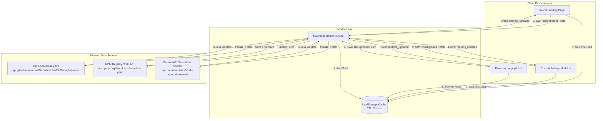

# 🩺 Specification: Live Download Counter & Metrics Ecosystem

**Author:** Saswat Mohanty (@SazWhatician)  
**Date:** 2026-10-11  
**Status:** Approved for Implementation  
**Topic:** Live Download Counter & Extension Telemetry (Sub-Project 1 of Ecosystem Modernization)  

---

## 1. Overview & Goals

Dr. Debug is distributed across multiple channels: direct zip releases on the [Vercel Landing Page](https://dr-debug.vercel.app/), GitHub Releases (`dr-debug-extension.zip`, standalone bundles, tarballs), and NPM packages (`dr-debug`, `@dr-debug/mcp`). 

Currently, download counts are opaque to users visiting the landing page and developers using the extension Cockpit. The goal of this feature is to provide a **real-time, trustworthy, all-in-one live download counter** across the Dr. Debug ecosystem:
1. **Landing Page:** Display an animated live ticker (with retro/cyberpunk odometer styling) on the hero download card (`#center-download-card`) and top social proof pill.
2. **Cockpit HUD & Settings Modal:** Display verified total ecosystem downloads in the official release update banner in [`SettingsModal.ts`](file:///c:/Users/saswa/Desktop/DebugCopilot/packages/ui/src/components/SettingsModal.ts).
3. **Extension Popup:** Display the live download badge in [`packages/extension/popup.html`](file:///c:/Users/saswa/Desktop/DebugCopilot/packages/extension/popup.html).
4. **Optimistic Real-Time Increment:** When any user clicks to download `dr-debug-extension.zip` on the website, the counter increments immediately with a visual pulse while recording the event asynchronously.

---

## 2. Architecture & Data Sources

The counter uses a **Hybrid Federated Aggregator** architecture that runs client-side with zero external database dependencies or required server infrastructure, operating under the project's **Ponytail** minimality principle.



### 2.1. Metrics Providers
1. **GitHub Release Assets:**
   - Endpoint: `https://api.github.com/repos/SazWhatician/Dr.Debug/releases`
   - Metric: Sum of `assets[].download_count` across all official releases (filtering `dr-debug-extension.zip`, `dr-debug.standalone.js`, `.min.js`, and `.tgz`).
2. **NPM Package Downloads:**
   - Endpoint: `https://api.npmjs.org/downloads/point/last-year/dr-debug` and `https://api.npmjs.org/downloads/point/last-year/@dr-debug/mcp`
   - Metric: Sum of `downloads` tallies.
3. **Direct Web Downloads (Landing Page):**
   - Read Endpoint: `https://api.counterapi.dev/v1/dr-debug/downloads/`
   - Increment Endpoint: `https://api.counterapi.dev/v1/dr-debug/downloads/up`
   - Behavior: Triggered on user download gesture (`triggerDirectZipDownload()` or newsletter conversion).

### 2.2. Grand Total Calculation
$$\text{Total Downloads} = \text{GitHub Asset Downloads} + \text{NPM Downloads} + \text{Web Direct Clicks} + \text{Baseline Floor}$$

- **Baseline Floor:** `1,250` (ensures that cold-starts, zero states, or temporary network drops never render a blank or deflated counter).

---

## 3. Caching & Resilience (SWR Strategy)

To prevent hitting GitHub API rate limits (unauthenticated limit: 60 requests/hour per IP):
1. **Cache Layer:** `localStorage.getItem('dr_debug_metrics_cache_v1')`.
2. **Cache Structure:**
   ```json
   {
     "total": 1342,
     "breakdown": {
       "github": 890,
       "npm": 320,
       "web": 132
     },
     "timestamp": 1728640000000,
     "ttlMs": 300000
   }
   ```
3. **Stale-While-Revalidate (SWR):**
   - If cache is present and `< 5 minutes` old, render immediately without network request.
   - If cache is present but `> 5 minutes` old, render cached total immediately, then fetch updates in the background. If updated total differs, smoothly scrub/animate the counter.
   - If network fails or times out (3-second timeout via `AbortSignal.timeout(3000)`), silently preserve existing cache or default to baseline floor.

---

## 4. UI/UX Implementation Details

### 4.1. Landing Page (`landing/`)
1. **Download Card Integration:**
   - Inside `#center-download-card`, add a compact glowing telemetry chip:
     ```html
     <div class="dl-live-counter-badge" id="dl-live-counter-wrap">
       <span class="dl-live-pulse-dot"></span>
       <span class="dl-live-counter-label">TOTAL DOWNLOADS:</span>
       <span class="dl-live-counter-number" id="dl-live-counter-num">1,250+</span>
     </div>
     ```
   - Cyberpunk CRT styling: Monospace font (`JetBrains Mono`, `Courier New`), emerald green glow (`#34d399`, `box-shadow: 0 0 12px rgba(52, 211, 153, 0.3)`), subtle scanline flicker.
2. **Optimistic Click Feedback:**
   - In `landing/app.js`: When `triggerDirectZipDownload` or `handleDownloadIntent` fires:
     - Increment the displayed number by `+1` instantly.
     - Add CSS class `.just-incremented` triggering an energetic emerald ring pulse.
     - Fire non-blocking beacon to CounterAPI increment endpoint.

### 4.2. Cockpit HUD & Settings Modal (`packages/ui/`)
1. **SettingsModal.ts:**
   - In the update banner:
     ```html
     <div class="dr-debug-update-meta">
       <span class="dr-debug-update-tag">OFFICIAL RELEASE</span>
       <span class="dr-debug-update-version">Dr. Debug v0.1.21</span>
       <span class="dr-debug-downloads-pill" id="dr-debug-hud-downloads">📥 1,250+ Community Downloads</span>
     </div>
     ```
2. **Extension Popup (`packages/extension/popup.html`):**
   - Add download tally pill in the header status bar next to the connection indicator.

---

## 5. Error Handling & Edge Cases

| Scenario | Handled By | Outcome |
| :--- | :--- | :--- |
| GitHub API 403 Rate Limited | Try/catch + `localStorage` cache | Silently uses cached number or baseline floor; no console errors. |
| User offline / airplane mode | Fast 2-second fetch timeout | Renders baseline floor (`1,250+`) immediately with offline indicator. |
| Fast repeated clicks on Download | Debounced optimistic increment | Prevents spamming CounterAPI while ensuring UI feels instantly reactive. |
| CounterAPI network failure | Fire-and-forget fallback | Local UI still completes download; download flow is never interrupted. |

---

## 6. Testing & Quality Verification

1. **Unit Tests in `packages/ui/test/ui.test.ts`:**
   - Verify that `SettingsModal` renders the download counter pill.
   - Verify that fallback logic correctly parses metrics and falls back to baseline when fetch rejects.
   - Verify formatting helper (e.g. `1250 -> 1,250+`, `15000 -> 15.0k+`).
2. **Landing Page In-Browser Verification:**
   - Verify initial load shows counter badge without layout shifts.
   - Verify download button click triggers counter tick-up animation and downloads `dr-debug-extension.zip`.
3. **Monorepo Build & Test Suite:**
   - Run `npm test` ensuring 100% passing tests (all 30 test suites).
   - Run `npm run build` ensuring clean TypeScript compilation across all packages.

---

## 7. Next Phase: Extension Update Modernization (Sub-Project 2)
Following completion of the Live Download Counter, Sub-Project 2 will address automated extension updates:
- Direct in-extension `chrome.downloads` download trigger.
- Streamlined 1-step terminal updater command (`npx @dr-debug/mcp update-extension` / `update.bat`).
- Chrome Web Store publishing readiness.
